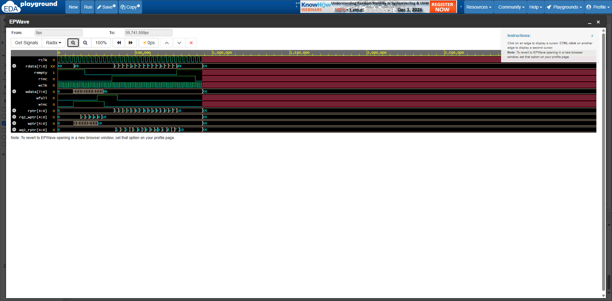
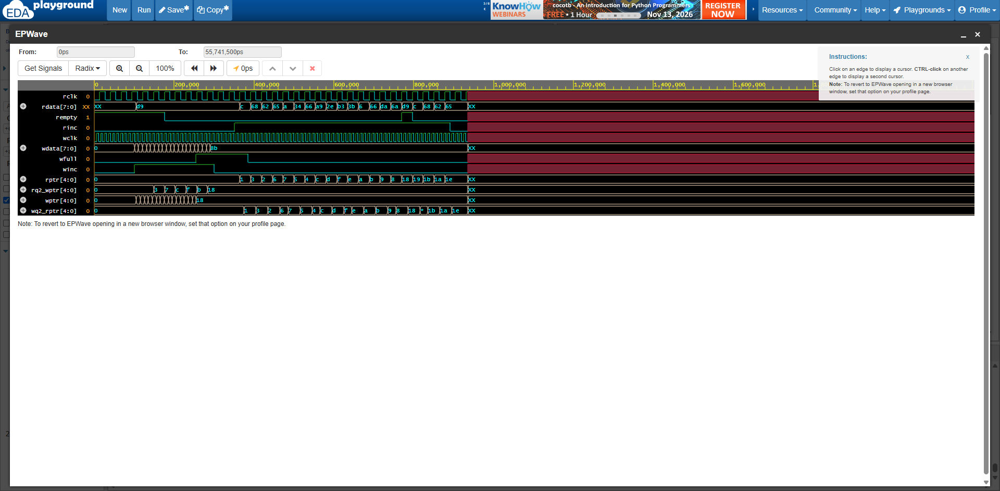

# Asynchronous FIFO: RTL Design and UVM Verification

A parameterized **asynchronous (dual-clock) FIFO** in SystemVerilog, verified with a **UVM 1.2** environment using constrained-random stimulus, a reference-model scoreboard, SystemVerilog Assertions (SVA), functional coverage, and a Python multi-seed regression runner. The testbench is validated by **deliberately injecting RTL bugs** and recording which check catches each one.


> **Run it yourself:** [EDA Playground (directed testbench + RTL)](https://edaplayground.com/x/iRt2). Open the link, click **Run**, and the log should print `DIRECTED TEST PASSED`.

---

## Why this project

Clock domain crossing (CDC) is one of the most common sources of silicon bugs, and rate-adaptation FIFOs sit at the heart of high-bandwidth networking and die-to-die interfaces. This project covers the full flow: design the FIFO, build a reusable UVM testbench, measure coverage, and prove the testbench actually catches bugs.

## Design overview

Cummings-style architecture:

```
        WRITE DOMAIN (wclk)                          READ DOMAIN (rclk)
   +---------------------------+              +---------------------------+
   |  wptr_full                |   wptr(gray) |  sync_w2r (2-FF)          |
   |  - binary + gray pointer  |------------->|                           |
   |  - full flag              |              +-------------+-------------+
   +-------------+-------------+                            |
                 | waddr                                    v
                 v                              +---------------------------+
          +-------------+          raddr        |  rptr_empty               |
 wdata -->|   fifomem   |<----------------------|  - binary + gray pointer  |--> rempty
          | (dual-port) |--> rdata              |  - empty flag             |
          +-------------+                       +-------------+-------------+
                 ^                                            |
   +-------------+-------------+              +---------------+-----------+
   |  sync_r2w (2-FF)          |<-------------|        rptr(gray)         |
   +---------------------------+              +---------------------------+
```

| Feature | Detail |
|---|---|
| Parameters | `DATA_WIDTH` (default 8), `ADDR_WIDTH` (default 4, so depth = 16) |
| Pointers | `ADDR_WIDTH + 1` bits (extra MSB distinguishes full from empty) |
| CDC | Gray-coded pointers through 2-flop synchronizers |
| Full | Next write Gray pointer equals synced read Gray pointer with the top 2 bits inverted |
| Empty | Next read Gray pointer equals synced write Gray pointer |
| Flags | Conservative: they may lag, but are never wrong in the unsafe direction |
| Reset | Asynchronous assert, synchronous deassert, per domain |

Full specification: [`docs/spec.md`](docs/spec.md)

## Verification plan

```
test
 └── env
      ├── wr_agent  (sequencer, driver, monitor)
      ├── rd_agent  (sequencer, driver, monitor)
      ├── scoreboard     (queue-based reference model)
      └── coverage       (fill level, transitions, clock-ratio cross)
```

- **Constrained-random** write and read traffic with independent, configurable delays
- **Scoreboard** with a queue reference model: data integrity, ordering, underflow, and leftover-entry checks
- **SVA** bound to the DUT: Gray pointers change by at most 1 bit per clock, no write accepted while full, no read accepted while empty, `wfull` and `rempty` never both high, correct reset values
- **Functional coverage**: fill-level bins, full/empty transitions, clock ratio x fill level cross
- **Configurable clock ratios** via plusargs: `+WCLK_PS=<ps> +RCLK_PS=<ps>`
- **Python regression**: multi-seed runs, log parsing, pass/fail summary with reproducible failing seeds

## Bug injection (testbench quality check)

Bugs are enabled at compile time with `+define+BUG_n`. The goal is to show that the verification environment, not just the RTL, is correct.

| Bug | Description | Directed TB | UVM scoreboard | SVA |
|---|---|---|---|---|
| `BUG_1` | Binary pointer crosses clock domains instead of Gray | Passes (RTL sim has no bit skew, so this is expected) | TBD | TBD (expected to catch) |
| `BUG_2` | Full compare missing MSB inversion | TBD | TBD | TBD |
| `BUG_3` | Write accepted while full (overflow) | TBD | TBD | TBD |
| `BUG_4` | Read pointer increments while empty (underflow) | TBD | TBD | TBD |

*TBD entries are filled in as each phase is completed. Only measured results are recorded here.*

### Example waveforms

BUG_1: binary pointers cross the clock domain, so multiple bits change at once in the synchronized copy:



BUG_4: the read pointer keeps advancing while `rempty` is high:



## Project status

- [x] Spec and RTL (`fifomem`, 2-FF synchronizers, `wptr_full`, `rptr_empty`, top)
- [x] Self-checking directed testbench (queue model, two clock domains)
- [x] Bug-injection switches in RTL (`BUG_1` to `BUG_4`)
- [x] UVM skeleton (interfaces, `tb_top`, package, base test, env)
- [ ] UVM agents (write and read: item, driver, monitor)
- [ ] Scoreboard and sequences/tests
- [ ] SVA module and bind
- [ ] Functional and code coverage
- [ ] Bug-detection matrix completed
- [ ] Python multi-seed regression script
- [ ] Final results (coverage numbers, regression summary)

## Repository structure

```
.
├── docs/            spec, test plan, images
├── rtl/             fifomem, sync_r2w, sync_w2r, wptr_full, rptr_empty, async_fifo
├── sim/             directed_tb.sv, files.f
├── tb/
│   ├── if/          wr_if, rd_if (clocking blocks)
│   ├── pkg/         fifo_pkg (includes all UVM classes)
│   ├── agents/      wr_agent, rd_agent
│   ├── env/         scoreboard, coverage, env
│   ├── seq/         sequences and virtual sequence
│   ├── tests/       base_test and derived tests
│   └── top/         tb_top (clocks, DUT, config_db, run_test)
├── sva/             assertions and bind
├── scripts/         run_regress.py
└── eda_playground/  combined design.sv / testbench.sv used on EDA Playground
```

## How to run

### Option 1: EDA Playground (no install)

1. Open the [playground link](https://edaplayground.com/x/iRt2).
2. Select **Aldec Riviera-PRO**. For the UVM testbench, set **UVM / OVM** to **UVM 1.2** and Run Options to `+UVM_TESTNAME=base_test`.
3. Click **Run**.
4. To inject a bug, put `+define+BUG_2` (or `BUG_1`, `BUG_3`, `BUG_4`) in **Compile Options**.
5. To change clock ratios, add `+WCLK_PS=4000 +RCLK_PS=40000` to Run Options.

### Option 2: Local simulator (VCS / Questa / Xcelium)

Commands and a Makefile will be added with the regression script.

## Tools

SystemVerilog, UVM 1.2, SVA, Python 3, Aldec Riviera-PRO (via EDA Playground), Git

## Author

**Chetan Meshram**
GitHub: [@chetanmeshram10](https://github.com/chetanmeshram10)
